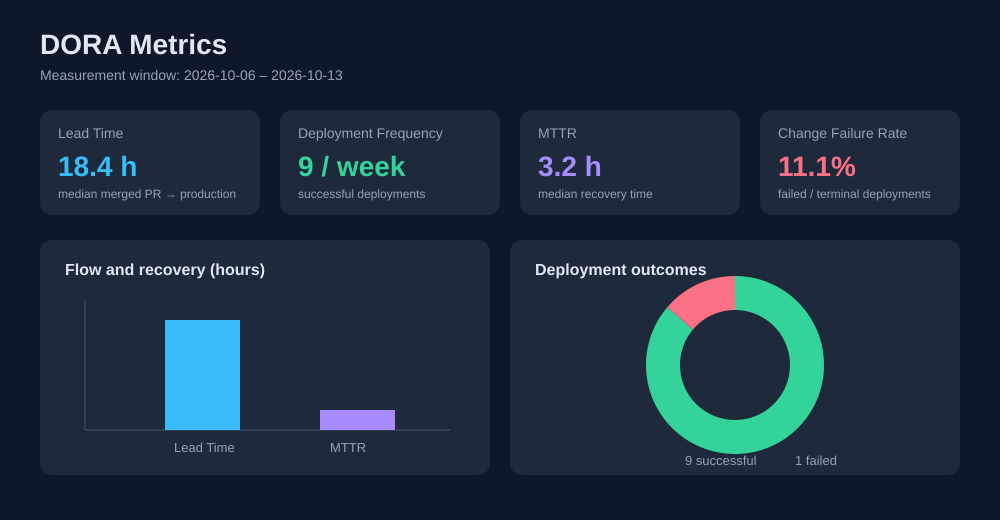

# Git/GitHub Practice

## 학습 목표
- Git의 기본 명령어 익히기
- GitHub 저장소 생성 및 관리
- 커밋과 푸시 과정 이해하기

## DORA 4대 지표 자동 수집

[`dora-metrics.yml`](.github/workflows/dora-metrics.yml)은 매주 월요일과 수동 실행 시
최근 7일의 **Lead Time, Deployment Frequency, MTTR, Change Failure Rate**를 GitHub
Deployments API에서 계산합니다. 실행 결과는 `dora-metrics.json`과 `weekly-report.md`
아티팩트로 90일간 보관됩니다. 수동 실행의 `window_days` 입력으로 측정 기간을 바꿀 수
있습니다.

### 대시보드 시안

Chart.js로 만든 정적 대시보드는 [`docs/dora-dashboard.html`](docs/dora-dashboard.html)에서
확인할 수 있습니다. 현재는 화면 예시용 데이터가 포함되어 있으며, Actions 아티팩트의
`dora-metrics.json`을 `data` 객체로 교체하면 실제 수치가 표시됩니다.

지표 정의와 계산 기준도 JSON에 함께 기록해 재현성을 확보했습니다. Lead Time과 MTTR은
중앙값을 사용하며, Change Failure Rate는 실패·오류·취소된 배포를 모든 종료 배포로 나눈
값입니다.