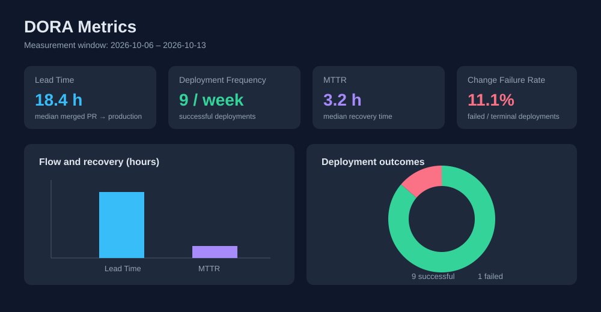

# Git/GitHub Practice

## 학습 목표
- Git의 기본 명령어 익히기
- GitHub 저장소 생성 및 관리
- 커밋과 푸시 과정 이해하기

## DORA 4대 지표 자동 수집

[`dora-metrics.yml`](.github/workflows/dora-metrics.yml)은 매주 월요일과 수동 실행 시
최근 7일의 **Lead Time, Deployment Frequency, MTTR, Change Failure Rate**를 GitHub
Deployments API에서 계산합니다. 실행 결과는 `dora-metrics.json`과 `weekly-report.md`
아티팩트로 90일간 보관됩니다. 수동 실행의 `window_days` 입력으로 측정 기간을 바꿀 수
있습니다.

### 대시보드 시안

Chart.js로 만든 정적 대시보드는 [`docs/dora-dashboard.html`](docs/dora-dashboard.html)에서
확인할 수 있습니다. 현재는 화면 예시용 데이터가 포함되어 있으며, Actions 아티팩트의
`dora-metrics.json`을 `data` 객체로 교체하면 실제 수치가 표시됩니다.



지표 정의와 계산 기준도 JSON에 함께 기록해 재현성을 확보했습니다. Lead Time과 MTTR은
중앙값을 사용하며, Change Failure Rate는 실패·오류·취소된 배포를 모든 종료 배포로 나눈
값입니다.

## 학습 습관 분석

[`docs/learning-analysis.html`](docs/learning-analysis.html)은 학습 기록의 `localStorage`
데이터를 바탕으로 요일별 학습 빈도, 총·평균 학습 시간, 완료율, 자주 학습한 주제와
간단한 학습 패턴을 분석합니다. 학습 기록 관리 페이지에서 기록을 추가한 뒤 분석 페이지를
새로고침하면 최신 결과를 확인할 수 있습니다.

## CI

`.github/workflows/ci.yml`은 `main`, 기능·수정 브랜치 push와 `main` 대상 Pull Request에서
Node.js 20·22와 Ubuntu·Windows 조합을 매트릭스로 검증합니다. `build` 단계가 조합별
아티팩트를 업로드하고, `test` 단계가 해당 아티팩트를 다운로드해 `npm test`를 실행합니다.
모든 테스트가 통과하면 `deploy` 단계가 검증된 아티팩트를 다시 모아 배포용 아티팩트로
업로드합니다. `npm run lint`는 Node.js 및 정적 페이지의 내장 JavaScript 문법을 확인합니다.

## GitHub Projects 계획·추적

이슈 생성 시 다음 Issue Form을 사용하면 계획에 필요한 정보와 완료 조건을 일정한 형식으로
수집할 수 있습니다.

- [Bug 템플릿](.github/ISSUE_TEMPLATE/bug.yml): 재현 절차, 영향 범위, 실행 환경, 증거 자료,
  완료 조건
- [Feature 템플릿](.github/ISSUE_TEMPLATE/feature.yml): 문제 정의, 사용자 스토리, 범위,
  수용 기준, 릴리스 계획, 작업 분해

두 템플릿은 저장소에 해당 라벨이 존재할 경우 `type: bug` 또는 `type: feature` 라벨을
자동으로 붙입니다. GitHub Projects에서 이 라벨을 기준으로 Bug/Feature 보기를 나누고,
`priority` 응답(P0~P3)을 Priority 필드와
동기화하면 백로그 우선순위와 진행 상황을 함께 추적할 수 있습니다. 이슈의 상태는 Projects의
기본 Status 필드에서 `Todo → In Progress → Done`으로 관리합니다.

# StudyInsight

**Learning Data Analysis & Grade Prediction Platform**

StudyInsight는 사용자의 학습 데이터를 활용하여 학습 패턴을 분석하고 예상 성적 및 학습 인사이트를 제공하는 프로젝트입니다.

## 1. Project Overview

학습 시간, 수면 시간, 스트레스 점수 등 다양한 학습 관련 데이터를 분석하여 학습 습관과 성적 사이의 관계를 파악하는 것을 목표로 합니다.

## 2. Main Features

- **Study Record Management**: 학습 데이터 입력 및 관리
- **Grade Prediction**: 머신러닝 기반 예상 성적 분석
- **Learning Pattern Analysis**: 학습 습관 및 패턴 분석
- **Data Visualization**: 분석 결과 시각화

## 3. Technology Stack

실제 프로젝트에서 사용하는 기술을 기재합니다.

| Category | Technology |
|---|---|
| Backend | Spring Boot |
| Language | Java |
| Machine Learning | Python, Scikit-learn |
| Database | 프로젝트 적용 DB |
| Version Control | Git, GitHub |

## 4. Project Structure

```text
StudyInsight/
├── docs/
│   └── adr/
├── .github/
│   └── workflows/
├── src/
├── README.md
├── LICENSE
├── CONTRIBUTING.md
└── CODE_OF_CONDUCT.md
```

실제 프로젝트 디렉터리 구조에 맞춰 수정해주세요.

## 5. Getting Started

### Requirements

- Java 17 이상 (실제 프로젝트 설정 확인 필요)
- Python (머신러닝 모듈 사용 시)
- Git

### Clone Repository

```bash
git clone https://github.com/hyunmin726/Work.git
cd Work
```

### Run Application

Spring Boot 프로젝트라면 Gradle Wrapper를 이용할 수 있습니다.

```bash
./gradlew bootRun
```

Windows 환경에서는 다음 명령어를 사용합니다.

```bash
gradlew.bat bootRun
```

실제 실행에 필요한 DB 및 환경 변수 설정은 별도로 확인해야 합니다.

## 6. Contribution

StudyInsight는 오픈소스 협업을 지향합니다.

버그 수정, 기능 개선, 문서 작성 등의 기여를 환영합니다.

기여 전 [CONTRIBUTING.md](CONTRIBUTING.md)를 확인해주세요.

## 7. Documentation

- [Getting Started](Wiki 링크)
- [Development Guide](Wiki 링크)
- [Troubleshooting](Wiki 링크)

## 8. License

This project is licensed under the MIT License.
See the [LICENSE](LICENSE) file for details.

## 9. Code of Conduct

프로젝트 참여자는 [CODE_OF_CONDUCT.md](CODE_OF_CONDUCT.md)의 협업 규칙을 준수해야 합니다.
